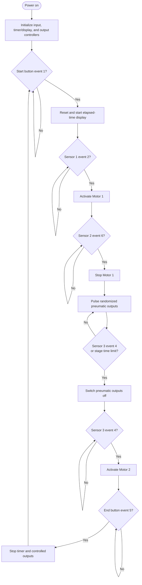

# Super Wario — Interactive Game Control System

Super Wario is an interactive, timed game built around custom electronics and
embedded firmware. Sensors and buttons report player progress to the control
electronics; the system updates the timer display and operates motors and
pneumatic mechanisms as the player moves through the game.

I designed and built the electronics and software for this project myself,
including the control boards, PCB designs, firmware, and system integration.

*Control electronics and displays during system integration.*

## System Overview

The project combines a physical game structure and mechanisms with a
microcontroller-based control system:

1. Buttons and sensors detect game events.
2. The input firmware sends numbered event messages over a serial connection.
3. The main firmware manages the elapsed-time display, while the output
   firmware advances the game sequence.
4. The output firmware switches the motor and pneumatic control outputs.
5. Separate driver boards interface the low-voltage control signals to the
   motors, pneumatic equipment, and switched loads.

The output-controller firmware describes this game sequence:

| Event ID | Game event | Controller action |
|---|---|---|
| `1` | Start button | Start a new round and reset the stage timer |
| `2` | Sensor 1 | Activate Motor 1 |
| `6` | Sensor 2 | Stop Motor 1 and begin the randomized pneumatic-output stage |
| `4` | Sensor 3 | Stop the pneumatic stage and activate Motor 2 |
| `5` | End button | End the round |

The output firmware also includes a timed stage/pass limit. The event IDs and
actions above describe the current firmware; the exact physical placement and
player-facing rules are best shown in a photo or diagram of the completed game.

## Hardware Overview

The hardware is modular, with separate control and driver boards for different
parts of the game:

| Hardware | Role |
|---|---|
| Main/control board | Reads low-voltage input signals, provides logic-level outputs, and connects to the timer display |
| Input controller | Scans buttons and sensors and reports input events to the other controllers |
| Pneumatic board | Provides eight input and eight output channels for controlling pneumatic equipment |
| Motor board | Uses a MOSFET to switch the motor speed-controller input; it does not directly drive the DC motor |
| Power board | Uses a relay to switch a load; the manual specifies a maximum current of 10 A |
| Display modules | Serial-connected two-digit modules used to show elapsed game time |
| Power supplies | The manual documents 12 V / 30 A and 5 V / 30 A supplies; the main board accepts 12–24 V input |
| Sensors and buttons | Active-low inputs; the documented installation uses two sensors and two buttons |

The current input firmware actively scans six input channels. The manual
describes two sensors and two buttons in the documented installation, so the
available channels and the installed game configuration are not necessarily
the same.

*Assembled main control board.*

*Pneumatic board with its input and output connections.*

*Pneumatic mechanism and game structure.*

The repository also contains PCB and schematic project files for the main,
motor, pneumatic, and power boards. For full connector descriptions and wiring
guidance, see the [PDF hardware manual](<Manual/Manual.pdf>) or the
[editable Word manual](<Manual/Manual.docx>).

> **Electrical safety:** The documented power board can switch AC or DC loads.
> Use suitable enclosures, isolation, wiring, and protection for the actual
> load and supply. Do not handle energized mains wiring.

## Firmware Overview

Firmware is written in C for Microchip PIC microcontrollers and is organized
into three MPLAB X projects:

| Firmware project | Microcontroller in source | Responsibility |
|---|---|---|
| `SuperWarioINPUTS.X` | PIC16F628A | Scans active-low inputs and transmits input numbers |
| `SuperWarioMAIN/SuperMarioMAIN.X` | PIC16F628A | Receives start/stop events and updates the elapsed-time display |
| `SuperWarioOUTPUTS.X` | PIC16F876 | Runs the game sequence and controls motor, pneumatic, and status outputs |

The firmware uses asynchronous UART serial communication configured for
9600 baud. Input messages are sent as ASCII event numbers followed by CR/LF.
The output controller uses the received events to step through the game and
generate timed, randomized activations on pneumatic output channels 1–8.
Motor-control signals are assigned to outputs 9 and 10; output 16 is also used
as a status/indicator signal in the output firmware.

The display code shifts digit data serially to the display hardware. Timing is
maintained by the microcontroller timers, while the output firmware also
enforces a time limit during a game stage.

### System algorithm

This is the high-level game flow represented by the firmware. Individual
controllers handle their own part of the sequence; see their guides for
implementation details.

For details about each firmware unit, see the dedicated guides:

- [Inputs firmware](SuperWarioINPUTS.X/README.md)
- [Main/timer-display firmware](SuperWarioMAIN/SuperMarioMAIN.X/README.md)
- [Outputs/game-sequence firmware](SuperWarioOUTPUTS.X/README.md)

## Repository Contents

- `doc/` — project and electronics photos used in this README.
- `Manual/` — PDF and editable Word hardware manuals.
- `SuperWarioINPUTS.X/` — input-controller firmware.
- `SuperWarioMAIN/SuperMarioMAIN.X/` — timer/display-controller firmware.
- `SuperWarioOUTPUTS.X/` — output and game-sequence firmware.
- `SuperWarioPCB/` — main-board PCB and schematic projects.
- `SuperWarioPCB - MotorBoard/` — motor-driver PCB and schematic.
- `SuperWarioPCB - PneuBoard/` — pneumatic-board PCB and schematic.
- `SuperWario - PowerBoard/` — power-board PCB and schematic.
- `SuperWarioINPUTS_Proteus/`, `SuperWarioOUTPUTS_Proteus/`, and
  `SuperWarioMAIN/SuperMarioMAIN - Proteus/` — Proteus simulation projects.

Compiler used for the firmware is XC8 V1.38. The checked-in projects are legacy
embedded projects and may require a compatible MPLAB X setup to rebuild.

## Photos and Screenshots to Add

The existing images document the electronics and pneumatic mechanism. For a
clearer project presentation on GitHub, I recommend adding:

- A clean, well-lit overall photo of the **completed game**, ideally from the
  player's point of view.
- Close-up photos of each finished PCB (main, input, pneumatic, motor, and
  power boards), preferably showing both component and solder sides.
- A close-up of the display while the timer is running.
- A labeled system/block diagram showing sensors, controllers, driver boards,
  power supplies, motors, and pneumatic equipment.
- A short video or GIF showing a complete game round and the mechanisms
  responding to sensor events.

These additions would show the finished player experience and make the
electronics easier to identify than the current bench-assembly photos.
