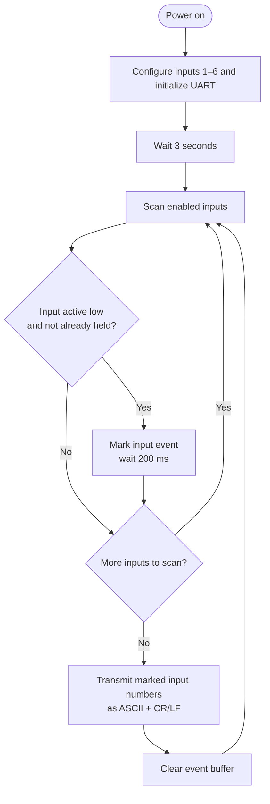

# Inputs Firmware

This MPLAB X firmware project scans the physical buttons and sensors and
reports detected events to the other controllers over UART. The source is in
[`main.c`](main.c), with the UART routines in [`UART.c`](UART.c) and
[`UART.h`](UART.h).

## What it does

- Configures six active-low digital inputs.
- Detects a new activation and applies a simple 200 ms delay for debounce.
- Sends the activated input number as ASCII followed by carriage return and
  line feed (`CR/LF`).
- Configures UART for 9600 baud; the UART implementation uses a 4 MHz clock
  and `SPBRG = 25`.

The firmware contains definitions for up to twelve input numbers, but only
inputs 1–6 are configured and actively scanned in the current source. Input
events are transmitted as their channel numbers; their game meanings depend on
the connected hardware and the receiving firmware.

## Algorithm

Per-input flags prevent a held button or sensor from sending the same event on
every scan. The event is eligible to be sent again after the input returns
inactive and is activated again.

## Input pins

| Input | PIC16F628A pin |
|---|---|
| 1 | RB3 |
| 2 | RB0 |
| 3 | RA5 |
| 4 | RA4 |
| 5 | RA3 |
| 6 | RA2 |

UART uses RB1 for RX and RB2 for TX. Input signals are active low, consistent
with the pull-up input arrangement documented in the
[hardware manual](../Manual/Manual.pdf). 

## Build

Open this directory's MPLAB X project and build the production configuration
with a compatible MPLAB X setup. Compiler used is XC8 V1.38. The generated
firmware artifacts are under `dist/`.

## Related documentation

- [Project overview](../README.md)
- [Hardware manual](../Manual/Manual.pdf)
- [Main-controller firmware](../SuperWarioMAIN/SuperMarioMAIN.X/README.md)
- [Output-controller firmware](../SuperWarioOUTPUTS.X/README.md)
