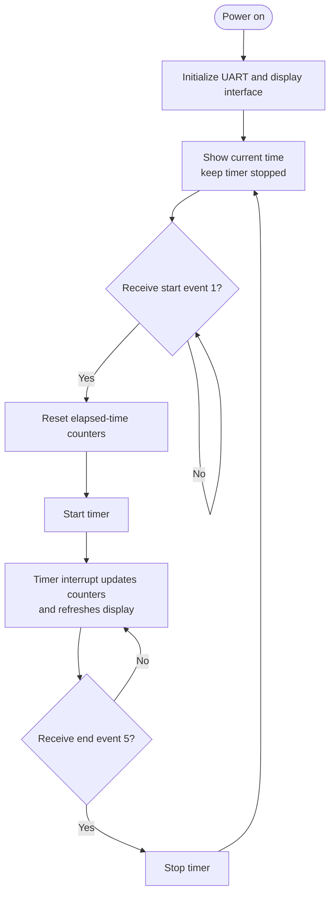

# Main / Timer Display Firmware

This MPLAB X firmware project receives event messages over UART and controls
the elapsed-time display. The source is in [`main.c`](main.c), with UART
support in [`UART.c`](UART.c) and [`UART.h`](UART.h).

## What it does

- Receives ASCII event numbers terminated by carriage return and line feed
  (`CR/LF`).
- Waits for event `1` before starting the timer.
- Resets and runs the timer after the start event.
- Stops the timer when event `5` is received.
- Converts time digits to segment patterns and shifts them to the display
  hardware.

The UART is configured for 9600 baud. The source uses a PIC16F628A and sets
the display shift-register data, clock, and latch signals on RB6, RB4, and RB5
respectively. UART uses RB1 for RX and RB2 for TX. The display connector and
power wiring are described in the [hardware manual](../../Manual/Manual.pdf).

## Event protocol

The receiver parses one- or two-digit ASCII numbers terminated by `CR`. The
input-controller firmware sends `CR/LF`, so the carriage return completes the
event and the line feed is not needed for parsing.

| Event | Timer behavior |
|---|---|
| `1` | Reset time and start counting |
| `5` | Stop counting |

The output-controller firmware also consumes game events. See its
[firmware guide](../../SuperWarioOUTPUTS.X/README.md) for the game sequence.

## Algorithm

Timer interrupts maintain the time counters and refresh the displayed digits.
The main loop waits for the start and end events received over UART.

## Build

Open this directory's MPLAB X project and build the production configuration
with a compatible MPLAB X setup. Compiler used is XC8 V1.38. Generated firmware
artifacts are under `dist/`.

## Related documentation

- [Project overview](../../README.md)
- [Hardware manual](../../Manual/Manual.pdf)
- [Input-controller firmware](../../SuperWarioINPUTS.X/README.md)
- [Output-controller firmware](../../SuperWarioOUTPUTS.X/README.md)
