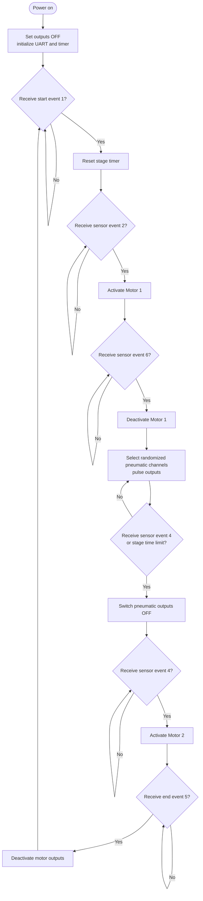

# Outputs / Game-Sequence Firmware

This MPLAB X firmware project runs the game sequence and controls the
low-voltage outputs connected to external motor and pneumatic driver
electronics. The source is in [`main.c`](main.c), with UART support in
[`UART.c`](UART.c) and [`UART.h`](UART.h).

## What it does

- Receives numbered events over UART and advances through the game stages.
- Starts a round on event `1`, then waits for sensor events.
- Activates Motor 1 after event `2`.
- On event `6`, stops Motor 1 and runs randomized, timed pneumatic output
  activations.
- On event `4`, leaves the pneumatic stage and activates Motor 2.
- Ends the game on event `5`.
- Enforces a time limit during a stage and reports status messages over UART.

The event sequence and meanings are based on the current firmware; the
physical sensor assignment is installation-specific.

## Algorithm

The firmware also monitors the end event and time limit while waiting between
stages. The algorithm is a functional summary; the source code defines the
exact timing and output transitions.

## Output channels

| Firmware output | PIC16F876 pin | Intended use in current source |
|---|---|---|
| 1–8 | RB7–RB0 | Pneumatic control channels |
| 9 | RC5 | Motor 1 control |
| 10 | RC4 | Motor 2 control |
| 11–12 | RA5, RA4 | Defined in firmware; not used in the main game sequence |
| 16 | RA0 | Status/indicator control |

These are logic-level control outputs, not direct motor or pump power outputs.
Use the appropriate external driver boards and supply wiring. See the
[hardware manual](../Manual/Manual.pdf) for board roles and connection
information.

## Serial interface

The firmware receives UART data on RC7 and transmits on RC6. UART is configured
for 9600 baud using the source's 4 MHz clock declaration and `SPBRG = 25`.
Received event numbers are ASCII digits terminated by carriage return.

## Build

Open this directory's MPLAB X project and build the production configuration
with a compatible MPLAB X setup. Compiler used is XC8 V1.38. Generated firmware
artifacts are under `dist/`.

## Related documentation

- [Project overview](../README.md)
- [Hardware manual](../Manual/Manual.pdf)
- [Input-controller firmware](../SuperWarioINPUTS.X/README.md)
- [Main/timer-display firmware](../SuperWarioMAIN/SuperMarioMAIN.X/README.md)
